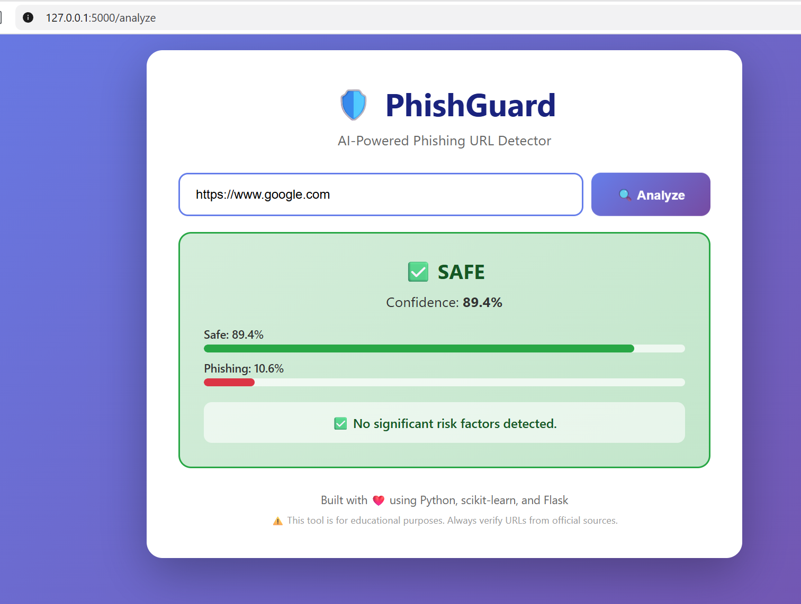
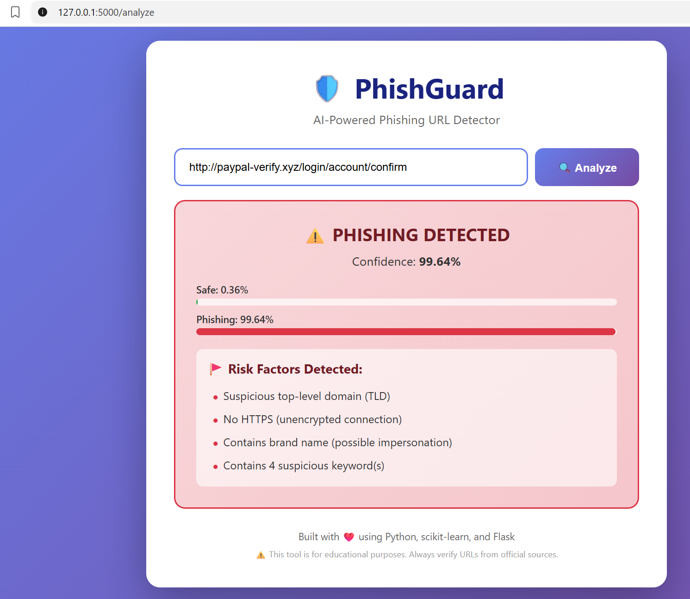
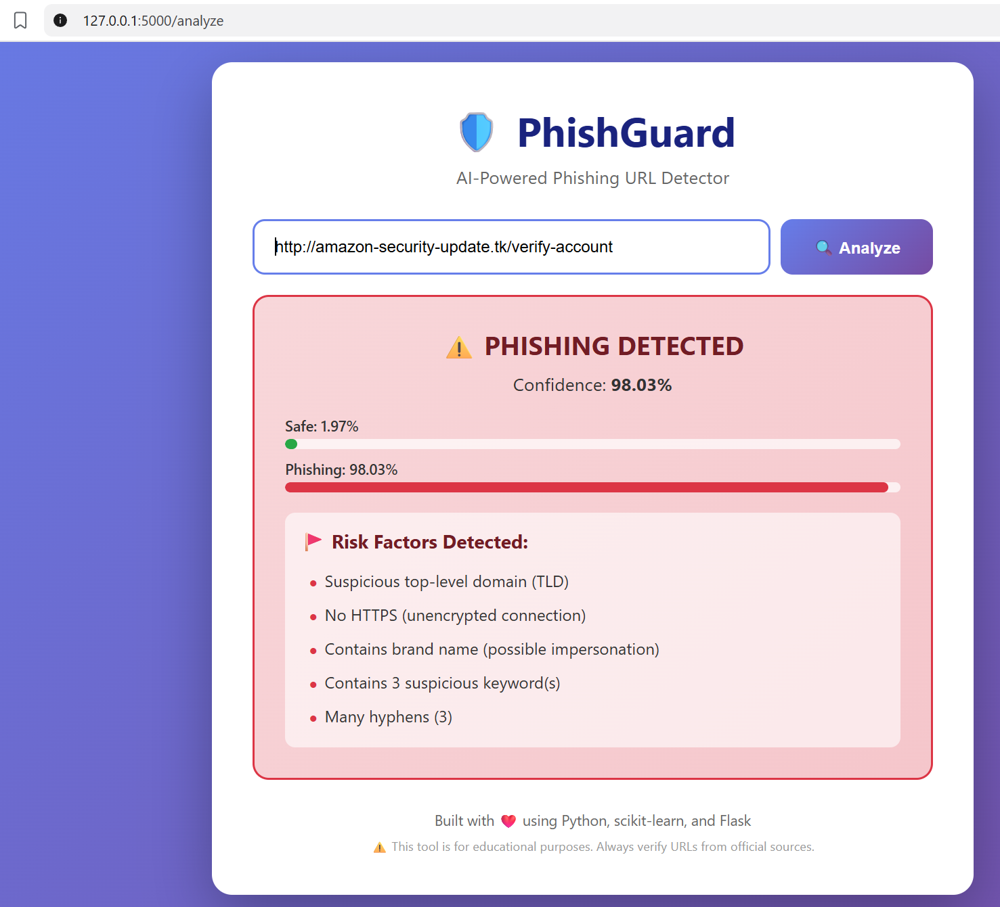

# 🛡️ PhishGuard — AI-Powered Phishing URL Detector


> **Detect phishing URLs in real-time using machine learning — trained on 200,000 labeled URLs with 91.33% accuracy.**

---

## 📖 Overview

**PhishGuard** is a cybersecurity tool that uses a Machine Learning model to detect phishing URLs. Users paste a URL into a clean web interface and receive:
- ✅ Verdict: **SAFE** or **⚠️ PHISHING**
- 📊 Confidence percentage
- 🚩 List of detected risk factors
- 📈 Probability breakdown

**All processing is local — no data sent anywhere.**

---

## 🎯 Features

- 🧠 **Random Forest ML Model** trained on 200,000 URLs
- 🌐 **Beautiful Flask Web Interface**
- 🔍 **26 Engineered URL Features**
- 🚩 **Risk Factor Analysis** (explains *why* a URL is suspicious)
- ⚡ **Instant Predictions** (milliseconds)
- 📊 **Probability Visualization** (bars for Safe vs Phishing)
- 🔒 **Privacy-First** (100% on-device)

---

## 📸 Screenshots

### 🏠 Home Page


### ✅ Safe URL Detection


### ⚠️ Phishing Detection


### 🚩 Risk Factors Display


---

## 🧠 How It Works

### 1. Feature Extraction
Each URL is transformed into **26 numerical features**:

| Category | Features |
|---|---|
| **Length** | url_length, hostname_length, path_length, tld_length |
| **Characters** | num_dots, num_hyphens, num_underscores, num_slashes, num_digits, num_special_chars |
| **Security** | has_https, has_ip_address, has_at_symbol, has_double_slash |
| **Domain** | num_subdomains, has_suspicious_tld, is_short_url, has_www, is_root_domain |
| **Brand** | has_brand, brand_in_path |
| **Keywords** | has_suspicious_keyword, suspicious_keyword_count |
| **Encoding** | has_hex_encoding, hex_count |

### 2. Machine Learning
- **Algorithm:** Random Forest Classifier (150 trees, max_depth=30)
- **Training Data:** 200,000 URLs (from 549,346 total dataset)
- **Train/Test Split:** 80/20
- **Accuracy:** 91.33%
- **Model Size:** 27 MB

### 3. Detection Pipeline
```
URL → Feature Extraction → ML Model → Prediction → Risk Analysis → Display
```

---

## 📊 Model Performance

| Metric | Value |
|---|---|
| **Accuracy** | **91.33%** |
| Precision | 80.09% |
| Recall | 85.59% |
| F1 Score | 82.75% |

### 🧪 Real-World Test Results

| URL | Verdict | Confidence |
|---|---|---|
| `https://www.google.com` | ✅ SAFE | 89.4% |
| `https://github.com` | ✅ SAFE | 66.5% |
| `https://www.paypal.com` | ✅ SAFE | 89.4% |
| `http://paypal-verify.xyz/login/account/confirm` | ⚠️ PHISHING | 99.6% |
| `http://amazon-security-update.tk/verify-account` | ⚠️ PHISHING | 98.0% |

---

## 🚀 Installation

### Prerequisites
- Python 3.12+
- pip

### Setup
```bash
# 1. Clone the repository
git clone https://github.com/polate77/phishguard-ai.git
cd phishguard-ai

# 2. Create virtual environment
python -m venv venv

# Windows:
venv\Scripts\activate
# macOS/Linux:
source venv/bin/activate

# 3. Install dependencies
pip install pandas numpy scikit-learn flask matplotlib seaborn joblib requests
```

### Run the Web App
```bash
python web_app/app.py
```

Open your browser to **http://127.0.0.1:5000**

---

## 🧪 Retrain the Model (Optional)

If you want to retrain from scratch:

```bash
python notebooks/02_train_model.py
```

This will:
1. Load the dataset (549,346 URLs)
2. Extract features from 200,000 samples
3. Train Random Forest + Logistic Regression
4. Save models to `models/`
5. Print accuracy + top features

**Runtime:** ~30 seconds on modern CPU

---

## 📁 Project Structure

```
PhishGuard/
├── data/
│   └── phishing_site_urls.csv          # 549K URL dataset (30 MB)
├── models/
│   ├── phishguard_rf.pkl               # Trained Random Forest (27 MB)
│   ├── phishguard_lr.pkl               # Trained Logistic Regression
│   └── feature_names.pkl               # Feature order for inference
├── notebooks/
│   ├── 01_explore_data.py              # Dataset exploration
│   ├── 02_train_model.py               # Training pipeline
│   └── 03_debug.py                     # Data sanity checks
├── screenshots/                        # Demo screenshots
├── web_app/
│   ├── app.py                          # Flask application
│   ├── templates/
│   │   └── index.html                  # Main UI
│   └── static/
│       └── style.css                   # Styling
├── feature_extractor.py                # URL → features
├── requirements.txt
├── .gitignore
└── README.md
```

---

## 🎯 Use Cases

- 🔍 **Personal Security:** Check suspicious links before clicking
- 📧 **Email Filtering:** Verify URLs in incoming emails
- 🎓 **Education:** Learn how ML detects phishing patterns
- 🛡️ **Research:** Base for deeper cybersecurity AI research

---

## ⚠️ Disclaimer

This tool is **for educational and research purposes only**. While it achieves 91% accuracy, no ML model is 100% reliable. **Always verify URLs from official sources before entering sensitive information.**

---

## 🛠️ Tech Stack

| Layer | Technology |
|---|---|
| **Language** | Python 3.12 |
| **ML Framework** | scikit-learn |
| **Web Framework** | Flask |
| **Data Processing** | pandas, numpy |
| **Serialization** | joblib |
| **Frontend** | HTML5, CSS3, Jinja2 |

---

## 🚧 Future Improvements

- [ ] Deploy to production (Render, Heroku)
- [ ] Browser extension (Chrome/Firefox)
- [ ] Real-time API endpoint
- [ ] Deep learning model (LSTM/Transformer)
- [ ] Support for detecting typosquatting
- [ ] WHOIS domain age check
- [ ] Multi-language URL support

---

## 👨‍💻 Author

**Mohammed El Khayat**
- 🎓 Student ID: **239J66**
- 🏫 Dalian Polytechnic University, China
- 🌍 From Morocco
- 🔗 GitHub: [@polate77](https://github.com/polate77)

---

## 📄 License

This project is licensed under the **MIT License** — feel free to use, modify, and share.

---

## 🙏 Acknowledgments

- Dataset: [Kaggle — Phishing Site URLs](https://www.kaggle.com/datasets/taruntiwarihp/phishing-site-urls)
- Built as a **cybersecurity portfolio project** for Master's applications

---

⭐ **If you find this project useful, please give it a star!** ⭐